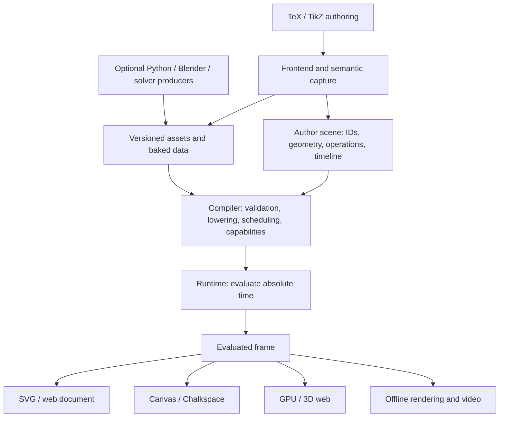

# Texloom: 범용 수학 애니메이션 로드맵

2026-10-02 · 조사와 구현을 함께 진행하는 실행 계획

### 2026-10-03 상태 추가: PR29 mesh와 3D 공간

PR29는 M4의 수치 기반을 구현한다. 버전 있는 indexed mesh/typed buffer,
명시적인 3D 단위와 오른손 Z-up 공간, 계층 affine 변환, 법선·반사·bounds,
affine camera view, 기존 자산 수명주기와 TeX 선언을 연결했다.
`NUMERIC_3D_PROFILE`로 정적인 3D 평가 결과를 소비하며 기존 2D 렌더러는
지원하지 않는 3D 기능을 진단한다. 상세 계약과 완료 기준은
[mesh·3D 공간 문서](mesh-space.md)에 정리한다.

**다음 PR30:** projection/camera 매개변수와 최초 3D 렌더링 프로필, 실제
화면·영상 검증. PR29에는 3D 타임라인 애니메이션, GPU 렌더링, 재질,
glTF/Blender 교환이 포함되지 않는다. 아래 초기 단계 표는 원래의 연구
계획이며, 이 상태 추가가 M4 전체의 완료를 뜻하지 않는다.

## 1. 목표와 현재 위치

**목표:** TeX로 작성한 수학·도형·관계·애니메이션을 공통 객체로 컴파일하고,
웹과 Chalkspace가 같은 장면을 소비한다. 장기적으로 곡선, 그래프, 수식 변환,
3D 곡면, 입자, 스칼라·벡터장, 외부 시뮬레이션까지 확장한다.

TikZ·Manim·Blender의 넓은 표현 범위를 목표로 한다. 기능별 지원 수준은
`native live / compiled static / baked / explicit fallback / unsupported`로
기록한다. 도구 전체와의 호환을 하나의 yes/no로 표시하지 않는다.

현재 v0.3은 실제 TeX 조판, PGF 앵커와 soft-path 캡처, 편집 가능한 2D 곡선,
관계·트랙, SVG·Canvas·웹·MP4를 지원한다. **M0 및 M1.1, M1.2의
reveal/point/tangent/normal**을 구현했다. 교차점과 실제 소비자 강의 통합은
다음 단계이며, M1 전체가 완료된 상태는 아니다.

## 2. 조사로 결정한 구조

- **PGF:** soft path 단계에서 선분·입방 곡선·닫힌 경로를 얻는다. 이름과
  연산 의도는 명시적으로 보존하고, 최종 그림의 외관은 기존 TeX/DVI 경로로
  검증한다. [PGF soft paths](https://tikz.dev/pgfsys-paths)
- **Manim:** 객체 계층, 부분 경로, 명시적인 변환 대응, sequence/parallel/stagger를
  가져올 설계 원리로 삼는다. 임의 Python updater의 상태 변화는 별도 bake
  경계에서 처리한다. [VMobject](https://docs.manim.community/en/stable/reference/manim.mobject.types.vectorized_mobject.VMobject.html),
  [AnimationGroup](https://docs.manim.community/en/stable/reference/manim.animation.composition.AnimationGroup.html)
- **Blender:** 원본 장면과 평가 결과, 기하 연산과 렌더링을 분리한다. 수정자·재질·
  시뮬레이션의 폭넓은 기능은 선택적인 producer/backend로 연결한다.
  [Dependency graph](https://developer.blender.org/docs/features/core/depsgraph/)
- **교환 포맷:** glTF는 지원되는 mesh/material/animation 전달에 사용하고,
  Texloom의 수학 관계와 강의 의도는 자체 IR에 보존한다.
  [glTF specification](https://registry.khronos.org/glTF/specs/2.0/glTF-2.0.html)

상세 근거: [TikZ·Manim 조사](research/tikz-manim.md),
[Blender·웹 런타임 조사](research/blender-runtime.md),
[Chalkspace·Lemniro 코드 감사](research/consumer-audit.md).

## 3. 소유권과 확장 계약

| 계층 | 책임 | 계약 |
| --- | --- | --- |
| Author frontend | TeX 문법, 이름, 수학 의미, 사용자 의도 | 소스 위치와 stable ID, 진단 가능한 lowering |
| Geometry kernel | 경로·mesh·bounds·샘플·미분·교차 | 타입화된 입력/출력, 단위·공간·허용 오차 |
| Operation graph | 의존 관계, 파생 기하, 명시적 연산 | DAG, 단일 writer 또는 선언된 합성, 연산 버전 |
| Timeline | 시작·길이·easing·조합·시간 재매핑 | 호스트 절대시간 → 장면 절대시간 |
| Resource store | 폰트 윤곽, mesh, 텍스처, 샘플 데이터 | content hash, producer 버전, bounds, async 준비 상태 |
| Evaluator | 한 시각의 완성된 상태 계산 | 입력 불변, seek 순서와 export fps에 독립 |
| Renderer | 완성된 상태의 SVG/Canvas/GPU 표현 | 기능 프로필, 명시적 손실 보고, 독립적인 시간 계산 없음 |
| Consumer | 블로그 문서 또는 강의의 배치·카메라·재질·음성 | 외부 clock, clip placement, mount/dispose, export hook |

TeX/DVI/SVG 원본은 재현·비교용 provenance와 artifact로 보관한다. 런타임
객체의 stable ID는 SVG DOM ID나 글리프 번호로 대체하지 않는다.
IR에는 실행할 JS/Python 문자열을 넣지 않는다. 향후 플러그인은 허용된
`namespace.operation@version`, 입력 스키마, evaluator/producer 구현으로 등록한다.
지원되지 않는 연산은 빌드 실패 또는 사용자가 지정한 bake 경로로 분기한다.

2D는 기존 bp, x→오른쪽, y→아래, 회전 radians 계약을 유지한다. 3D를 추가할
때는 별도 world 공간·단위·축과 명시적 projection을 둔다. 2D 본문의 길이와
3D 물리 좌표를 같은 숫자 공간으로 암묵적으로 섞지 않는다.

## 4. 구현 순서와 완료 기준

| 단계 | 핵심 구현 | 완료를 판정할 데모와 검증 | 의존성 / 상태 |
| --- | --- | --- | --- |
| **M0 공통 실행 기반** | prepared runtime, 소비 기능 프로필, host clip 시간, native Canvas, 보드 배치 | 같은 frame을 SVG와 Canvas가 소비; clip/opacity/currentColor/TeX 기준점; 역탐색 | **이번 작업 완료**, 기존 IR 0.1/0.2 유지 |
| **M1 살아 있는 2D 기하 + 실제 소비자 연결** | 타입화된 다중 경로, PGF named soft-path capture, split/derivative/bounds/length, reveal, 점·접선·법선; 소비자 clip hook | 변형되는 곡선·접선·교차점이 웹과 기존 Chalkspace 강의에서 동일하게 재생·export | **기하·reveal·점·방향 구현**. 교차점·소비자 hook 진행 예정 |
| **M2 애니메이션 구성·수식 대응** | sequence/parallel/stagger, easing, 시간 warp, stable formula parts, 동일 topology morph | 식의 특정 항만 옮기는 유도 과정; 중복 기호 대응; 문장과 강의 cue 정렬 | M1 |
| **M3 수학 객체 라이브러리** | 좌표축·plot·불연속 구간, graph/tree/layout, braces/decorations, diagram constraints, live expression subset | 해석학 plot, 대수학 diagram, 집합·위상 예제; 파라미터 변화 | M1/M2, 각 기능마다 고정 fixture |
| **M4 3D 표현** | indexed mesh, instances, normals, cameras, unlit 우선·이후 PBR, TeX overlay; GPU adapter | torus/sphere와 moving labels, 궤도 카메라, 고정 시각 프레임 비교 | resource loader와 명시적 2D/3D 공간 |
| **M5 장·시뮬레이션** | 외부 binary samples, mesh-associated scalar/vector fields, chunks, bake manifests, interpolation | 곡면 위 해석적 모드 → 외부 수치 파동해의 재생; 뒤로 seek해도 동일 | M4, solver 검증과 렌더 검증 분리 |
| **M6 producer·교환·성능 확장** | Blender 평가 mesh/instance 추출, 제한된 glTF 입출력, optional offline render, 캐시·worker·LOD | 변환 보고서에 보존/구움/거부 항목; 큰 장면 성능 회귀 | 기능별 M3–M5, 전 범용 호환을 자동 가정하지 않음 |

### M1을 실행 가능한 작업으로 나누기

1. `PathGeometry`에 subpath ID, move/line/cubic/close, winding과 좌표 공간을 둔다.
   분할·평가·도함수·bounds는 DOM 없는 순수 함수로 구현한다.
2. PGF soft path capture에 작성자 ID를 연결한다. 원본과 변환된 경로를 구분하고
   텍스트·stroke 폭에 대한 PGF 변환 규칙을 fixture로 고정한다.
3. Reveal을 실제 부분 경로로 평가해 SVG/Canvas 양쪽에 전달한다. 진행률이
   parameter인지 arc length인지 명시한다. 글리프의 윤곽 순서를 사람의 획순으로
   간주하지 않는다.
4. `pointOnPath`, `tangent`, `normal`을 추가한다. 0 길이·cusp·비가역 변환은
   진단하며 임의의 좌표로 대체하지 않는다.
5. 교차점은 line/line, line/cubic부터 시작한다. root 허용 오차와 중복근 처리,
   `firstAlong` 또는 명시적 branch, `missing:hide|error`를 정한다. 프레임의
   이전 선택에 기대는 알고리즘은 순서 독립 seek 계약을 만족하도록 준비/bake한다.
6. Chalkspace에 명시적 외부 clip 배열과 `render` 내부 hook을 연결한다.
   활성 clip은 `frameKey`와 영상 캐시에 참여한다. Lemniro에는 검증된 asset
   manifest를 받는 React figure/player 컴포넌트를 둔다.
7. 같은 TeX 예제로 두 소비자의 실제 play/seek/export를 통과시킨 뒤 M1을 완료한다.

## 5. Chalkspace와 웹에서 공통으로 소비한다는 의미

공유 항목은 객체 ID, 기하, 관계, 시간, 수학 값이다. 강의의 분필 재질·지우개·
도구·음성은 Chalkspace가, 문단·검색·접근성·반응형 배치는 Lemniro가 소유한다.

Chalkspace 현행 `render`는 closure 내부에서 호출된다. 외부에서 공개 메서드만
바꾸는 방식은 실제 재생 경로를 모두 덮지 못한다. 또한 현재 영상 exporter는
`frameKey`가 같으면 렌더를 건너뛰므로 clip의 동적 구간을 포함해야 한다.
Lemniro 본문 sanitizer는 script/iframe을 거부하므로 React 컴포넌트 경계가 필요하다.
구체적 파일·줄 번호는 [소비자 감사](research/consumer-audit.md)에 있다.

M0 및 v0.3 데모는 **실제 Chalkspace board-surface 모듈 + native Canvas 경로**를
사용한다. 기존 강의 scheduler, chalk grain, stroke inference, eraser, 음성,
영상 캐시와의 전체 연결은 M1 이후의 별도 gate로 남겨뒀다.

## 6. 수학·기하·시뮬레이션의 검증

- 렌더가 성공했는지와 수학적으로 맞는지를 별도 검사한다. 해석적 곡선·미분은
  수치 reference와 비교하고, 수치 solver에는 discretization·boundary condition·
  수렴/오차 기록을 요구한다.
- 곡선 topology, 구멍과 winding, 대응되지 않는 수식 부분을 조용히 바꾸지 않는다.
  morph의 대응 관계를 작성자가 확인할 수 있게 한다.
- Stateful simulation은 fixed timestep·seed·버전·초기/경계조건으로 계산해
  자체 versioned sample/bake 데이터로 내보낸다. Blender의 내부 bake cache는
  일반 교환 파일로 사용하지 않는다.
- 렌더러의 geometry/time/resource 일치와 픽셀 허용 오차를 구분한다. 3D의 GPU별
  픽셀 차이를 2D와 같은 기준으로 무조건 처리하지 않는다.

## 7. 품질·성능·유지보수 gate

- 각 새 기능은 TeX 원본, 공통 IR, 수치 invariant, web/Canvas 그림, 역탐색을
  포함하는 작은 conformance fixture와 함께 추가한다.
- 경로 커널·clock·관계 계산을 소비자별로 복제하지 않는다. render backends가
  같은 입력 frame을 받아야 한다.
- resource parse/cache와 dependency scheduling 비용을 계측한다. 큰 장면은
  binary buffers, dirty dependencies, instances, worker/bake, LOD 순서로 검토한다.
- 첫 성능 기준선은 `tools/qa_dual.py`의 sample+Canvas 40회 측정이다. 환경·크기·
  장면을 기록하고, GPU/브라우저/대규모 장면에도 같은 속도가 난다고 추정하지 않는다.
- 기존 0.1/0.2 bundle을 계속 읽는다. 새 geometry/op가 도입될 때 새 schema와
  migration을 함께 제공한다. 기능 계획용 느슨한 `any` 확장 필드를 미리 넣지 않는다.
- 출처를 따온 코드는 upstream 파일·commit·license·수정 내역을 기록한다.
  지금은 PGF를 실행하고 자체 adapter를 사용한다. 선택적인 Blender 실행/파일
  교환과 Blender 소스의 직접 포팅은 분리해서 검토한다.

## 8. 이번 작업 결과 / 다음 재개 지점

- [x] 공식 자료를 근거로 한 2개 upstream 조사와 실제 소비자 코드 감사.
- [x] `prepareScene`, 기능 프로필·진단, 절대시간 clip binding.
- [x] native Canvas2D backend와 board-world 배치 adapter.
- [x] 실제 칠판 표면을 사용하는 동시 재생 데모와 브라우저 conformance.
- [x] M1.1 PathGeometry 커널 및 named PGF soft-path 캡처.
- [x] M1.2 reveal/point/tangent/normal 및 제어점 변형 트랙.
- [ ] **다음: M1.2 교차점의 명시적 branch/missing 정책과 수치 검증.**
- [ ] M1.3 실제 소비자 timeline/cache/component 통합과 영상 gate.

v0.3 구현은 `examples/living-paths.tex`, [문법](../tex/README-v03.md),
[IR 계약](ir-contract.md)에 정리했다. 라이브러리가 계산하는 곡선과 실제 PGF
출력 비교, 부분 reveal·제어점 변형 중 SVG/Canvas 비교, 역탐색을 검증한다.
PGF에서 이미 근사한 원/호는 해당 cubic으로 보존한다. 일반 TikZ 패키지의
모든 제약이나 동적 의미를 자동으로 복원하는 기능은 아니다.

완료 범위와 테스트 수치는 [v0.3 구현 기록](research/m1-implementation.md)을 참고한다.

빌드·재현: [공통 런타임 계약](runtime-contract.md). 이 문서의 체크박스와 각
gate의 검증 결과를 기능 구현과 같은 커밋에서 갱신한다.
